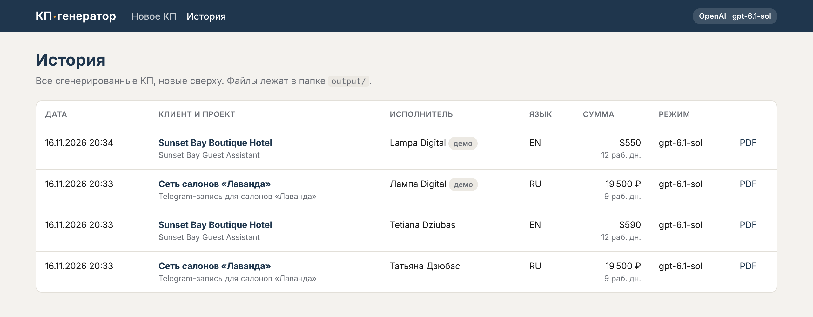
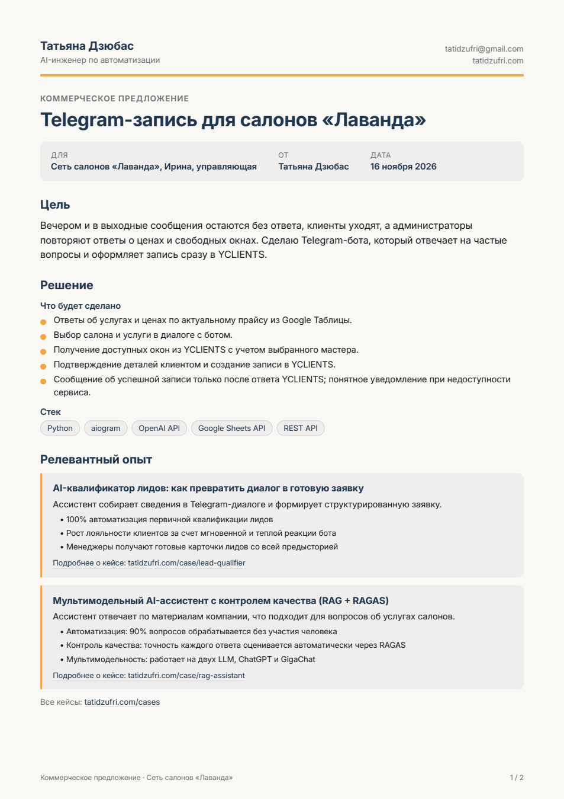
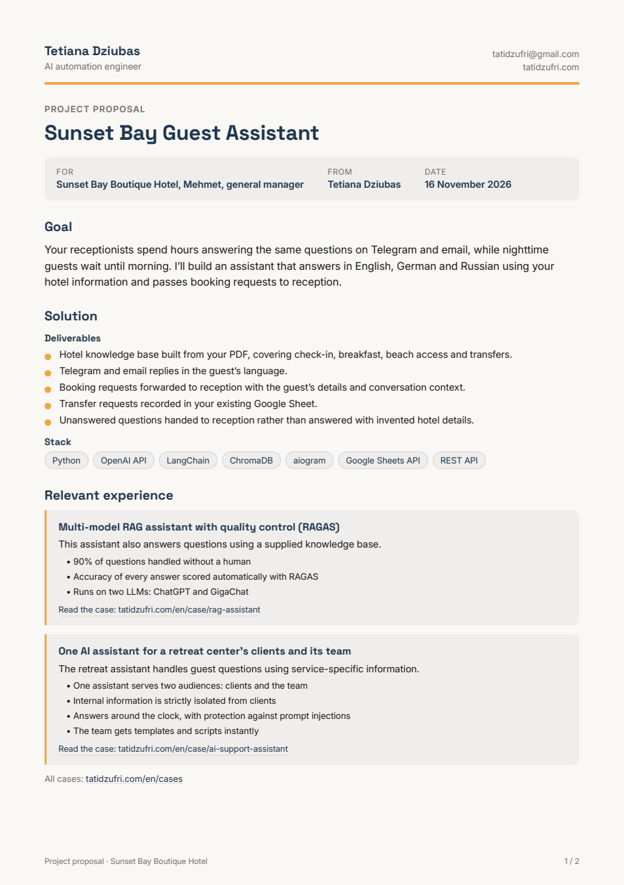

# Генератор коммерческих предложений по брифу

Веб-приложение для фрилансеров и небольших студий. После созвона с заказчиком заполняешь короткий бриф, а приложение собирает готовое КП в фирменном стиле исполнителя: цель, решение, подходящие кейсы из портфолио, этапы со сроками и стоимостью, условия, следующий шаг. На выходе HTML-превью и PDF, который можно сразу отправить клиенту.

Генератор универсальный. Исполнитель описан YAML-профилем: тон, правила текста, палитра, услуги, кейсы, условия оплаты. В репозитории два профиля: реальный (Татьяна Дзюбас, AI-автоматизация, 13 кейсов с tatidzufri.com) и вымышленное агентство «Лампа Digital», на котором видно, что генератор работает с любым исполнителем.


## Что внутри

- **Текст пишет LLM, деньги считает код.** Модель (OpenAI, Structured Outputs) заполняет содержательные поля и относит каждый этап к уровню сложности S, M или L. Часы, стоимость и сроки считает `kp/pricing.py` по ставке из `.env`. Модель не может «придумать» цену.
- **Кейсы подставляются из профиля.** Модель выбирает 1–3 кейса по id и объясняет, чем они похожи на задачу. Цифры результатов шаблон берет из профиля, поэтому LLM не может их исказить.
- **Проверка по Tone of Voice.** Стоп-фразы, эмодзи, буква «ё», конструкции вроде «не X, а Y», лимит длинных тире, одинаково начатые пункты, объем документа 250–400 слов. Если правила нарушены, генератор делает один повтор и передает модели список нарушений.
- **RU и EN.** Язык выбирается в форме, валюта следует за ним (₽ / $).
- **Mock-режим.** Без API-ключа приложение проходит весь цикл на заготовленных ответах, так что его можно запустить и посмотреть сразу после клона.
- **История.** Каждое КП сохраняется в `output/<дата>_<компания>_<время>/`: бриф, ответ модели, расчет, HTML и PDF.

## Скриншоты

| Бриф | История |
|---|---|
|  |  |

Готовый PDF (2 страницы A4), RU и EN:

| RU, стр. 1 | RU, стр. 2 | EN, стр. 1 |
|---|---|---|
|  |  |  |

Примеры PDF целиком: [docs/examples/KP_lavanda_ru.pdf](docs/examples/KP_lavanda_ru.pdf), [docs/examples/KP_sunset-bay_en.pdf](docs/examples/KP_sunset-bay_en.pdf). Оба сгенерированы моделью `gpt-6.1-sol` по брифам из `examples/`, без ручной правки.

## Быстрый старт

Нужны Python 3.11+ и системные библиотеки WeasyPrint (Pango). На macOS: `brew install pango`, на Ubuntu: `apt install libpango-1.0-0 libpangoft2-1.0-0`.

```bash
git clone <repo> && cd <repo>
make install      # venv, зависимости, .env из .env.example
make run          # http://127.0.0.1:5050
```

После `make install` приложение работает в mock-режиме (`KP_MOCK=1` в `.env`). Открой форму, нажми «Заполнить пример», затем «Сгенерировать КП».

Чтобы генерировать через OpenAI, в `.env` задай:

```dotenv
OPENAI_API_KEY=sk-...
OPENAI_MODEL=gpt-6.1-sol
KP_MOCK=0
```

Одно КП стоит около $0,02 и генерируется за ~20 секунд. Если ключа нет, приложение само переходит в mock-режим. В форме есть галочка «без API», чтобы проверить сценарий, не тратя токены.

Проверить окружение и прогнать тесты:

```bash
make check        # импортируются ли weasyprint, openai и остальные
make test         # 51 тест, без сети, ~2 с
KP_LIVE_TESTS=1 make test   # + 2 теста с реальным запросом к OpenAI
```

**Про macOS.** WeasyPrint ищет Pango в Homebrew через `DYLD_FALLBACK_LIBRARY_PATH`. SIP вычищает `DYLD_*` при запуске `/bin/sh`, поэтому `export` в Makefile не помогает, и переменная задается прямо перед `python` в каждой команде. Если запускаешь без make, пиши так: `DYLD_FALLBACK_LIBRARY_PATH=/opt/homebrew/lib .venv/bin/python ...`. Порт 5050 выбран потому, что 5000 на macOS занят AirPlay.

## Командная строка

```bash
.venv/bin/python -m kp.cli profiles
.venv/bin/python -m kp.cli generate --brief examples/brief_ru.json --profile tatiana
.venv/bin/python -m kp.cli generate --brief examples/brief_en.json --profile demo_agency --mock
```

Флаги: `--lang ru|en` переопределяет язык брифа, `--mock` включает генерацию без API, `--out DIR` задает папку для результата. Команда печатает режим, итоговую сумму, путь к PDF и предупреждения проверки.

Бриф — это JSON с полями `company`, `industry`, `task` (обязательные), а также `contact_name`, `budget`, `deadline`, `notes` и `language`. Примеры лежат в `examples/`.

## Скилл для Claude Code

В `.claude/skills/kp-generator/` лежит скилл, который собирает КП прямо из чата. Опиши заказчика своими словами, и скилл соберет `brief.json`, уточнит недостающие поля, запустит CLI, проверит результат и вернет путь к PDF. Скилл подхватывается автоматически, если открыть Claude Code в папке проекта.

## Как считается стоимость

```
часы этапа  = часы агента × KP_TEST_MULTIPLIER + часы коммуникации
цена этапа  = часы этапа × ставка + токены агента × курс   (вверх до 500 ₽ / $10)
дни этапа   = ceil(часы этапа / KP_HOURS_PER_CLIENT_DAY)
срок        = сумма дней + 1 день на согласование
```

| Уровень | Часы агента | Коммуникация | Токены |
|---|---|---|---|
| S | 1 | 2 | $10 |
| M | 2,5 | 3 | $30 |
| L | 6 | 5 | $75 |

Время агента умножается на 3: агент пишет код, а вдвое больше уходит на проверку и тесты. Последний этап (тестирование и сдача) всегда уровня S, потому что тесты уже заложены в каждый этап. Ставка по умолчанию — 500 ₽/ч и $12/ч: это минимальный уровень вайб-кодинга на Kwork и Upwork. Таблица уровней откалибрована по логам реальных задач в Claude Code. Все числа задаются в `.env`.

Расчет по этапам виден только исполнителю (боковая панель превью). В PDF попадают этапы, сроки и цены без часов и уровней.

## Профиль исполнителя

Профиль — это файл `profiles/<id>.yaml`. Он появится в списке формы без правки кода. Минимальный пример — `profiles/demo_agency.yaml`. Основные разделы:

```yaml
id: my_studio
demo: false                 # true — в КП ставится пометка «Демо-профиль»
executor:                   # имя, должность, слоган, контакты (ru/en)
brand:                      # primary, accent, background, text, heading_font, body_font
voice:                      # tone, rules, stop_phrases (ru/en), forbid_yo, forbid_emoji,
                            # max_long_dashes, word_limit: [250, 400]
services: {ru: [...], en: [...]}
skills: [FastAPI, PostgreSQL, ...]   # технологии помимо стека кейсов
tiers: {S: ..., M: ..., L: ...}      # что значит каждый уровень, подсказка для LLM
terms:                      # included, excluded, payment_options, next_step_fixed
optional_blocks:            # блоки с фиксированным текстом; LLM решает, включать ли
cases:                      # или cases_file: my_studio.cases.yaml
  - id: flower-shop
    title: {ru: ..., en: ...}
    summary: {ru: ..., en: ...}
    results: {ru: [...], en: [...]}   # цифры попадают в КП как есть
    stack: [WordPress, amoCRM API]
    when_to_use: интернет-магазины, интеграции с CRM
```

Шрифты Inter и Space Grotesk лежат в `fonts/` (лицензия OFL). В Space Grotesk нет кириллицы, поэтому в русских КП заголовки набираются Inter.

Кейсы реального профиля импортируются из кода сайта-портфолио скриптом `scripts/import_cases.py` в `profiles/tatiana.cases.yaml`.

## Структура

```
app.py                  Flask: форма, превью, PDF, история
kp/
  models.py             Pydantic: бриф, профиль, схема ответа LLM, проверки ответа
  prompts.py            системный и пользовательский промпты
  generator.py          OpenAI Responses API + mock, повтор по замечаниям
  tov_lint.py           проверка текста по голосу исполнителя
  pricing.py            часы, деньги, сроки
  render.py             HTML и PDF (Jinja2 + WeasyPrint)
  service.py            бриф → файлы в output/
  storage.py, profiles.py, config.py, cli.py
  templates/            шаблон КП и его CSS
web/                    шаблоны и стили веб-интерфейса
profiles/               YAML-профили исполнителей
fixtures/               ответы для mock-режима
examples/               примеры брифов RU/EN
tests/                  pytest
docs/                   скриншоты и примеры PDF
```

## Стек

Python 3.11 · Flask 3 · OpenAI Responses API (Structured Outputs) · Pydantic 2 · Jinja2 · WeasyPrint · PyYAML · python-dotenv · pytest

## Что дальше

- Редактор профиля в веб-интерфейсе вместо правки YAML.
- Пакетная генерация из CSV для рассылок по базе.
- Перегенерация одного раздела КП вместо всего документа.
- Другие провайдеры LLM: DeepSeek, GigaChat, YandexGPT.
- Импорт брифа из письма или из заказа на фриланс-бирже.
- Экспорт в DOCX.
- Публичное демо на поддомене tatidzufri.com.

## Происхождение

Проект вырос из учебного задания VM40 «КП на автопилоте» курса «Вайб-маркетинг», где КП генерировались из CSV для рассылки. Здесь он доработан до универсального генератора по брифу и сделан как финальный проект курса по Claude Code.

Автор: Татьяна Дзюбас, [tatidzufri.com](https://tatidzufri.com)
