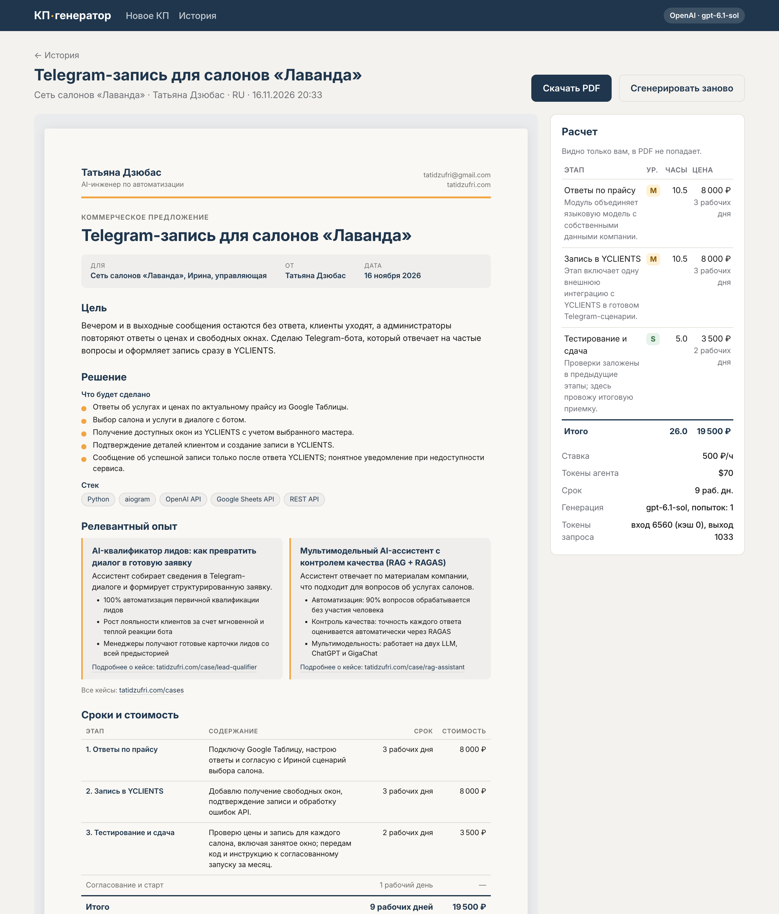
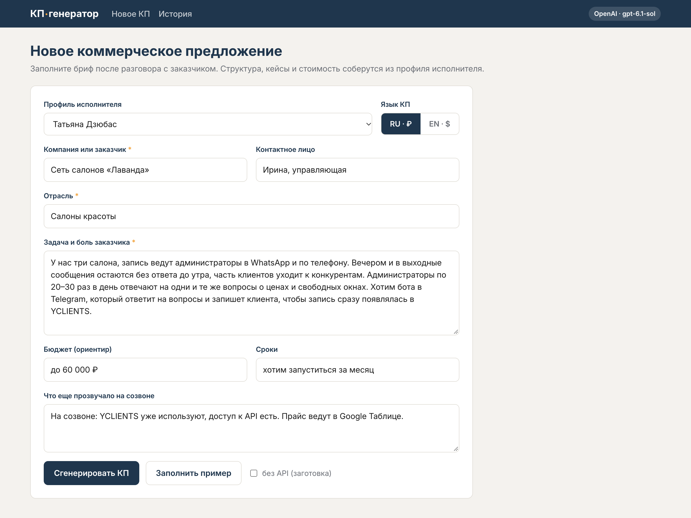
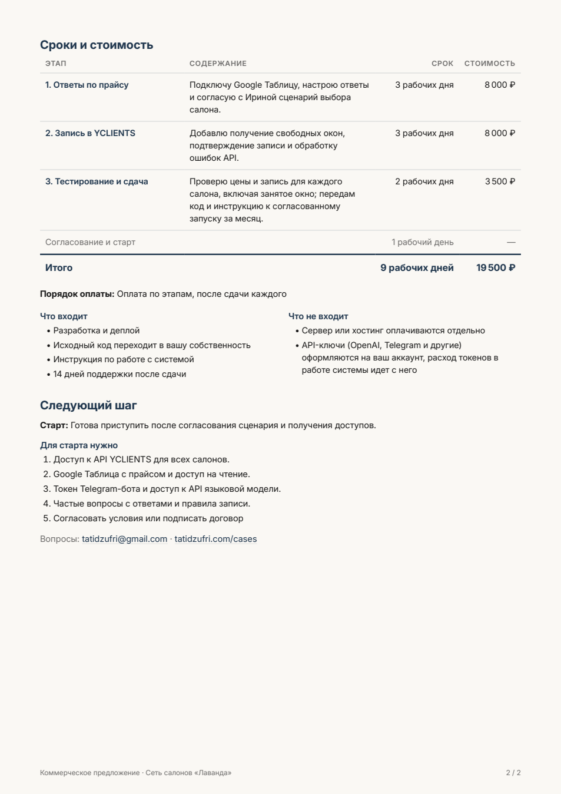

# Project proposal generator: a branded PDF built from a call brief

A web app for freelancers and small studios. After a call with a prospect I fill in a short brief, and a PDF proposal in my brand style is ready. Demo: [kp.tatidzufri.com](https://kp.tatidzufri.com).

This is a practice project. The interface and the proposals work in Russian and English. Case study: [tatidzufri.com/en/case/kp-generator](https://tatidzufri.com/en/case/kp-generator).



## About the project

A proposal is assembled from three sources. The brief gives the prospect's task in their own words. The provider profile in YAML gives the tone, writing rules, palette, services and case studies. An OpenAI language model writes the substance: goal, solution, stages, next step. Cost and timeline are calculated by code from the rate in the settings.

The generator works for any provider. The repository has two profiles: mine (AI automation, 13 case studies from [tatidzufri.com](https://tatidzufri.com)) and a fictional studio, "Lampa Digital". The second shows how the voice, cases and design change.

## The task

A proposal goes out after the first conversation, when the prospect is ready to work and waiting for details. Each time you have to match case studies to their task, lay out the stages, estimate hours and lay out the document. The text has to be written fresh: a beauty salon and a boutique hotel have different pains, and they spot generic words right away.

Ask a model to just write a proposal and it writes smoothly, but it easily invents numbers and experience the provider doesn't have. In a proposal every claim has to rest on a fact from the brief or from a real case study.

## How it works

I fill in a form: company, industry, the task in the prospect's words, budget, timeline, notes from the call. Then the pipeline runs.

1. **The model writes to a strict schema.** The answer is validated by a Pydantic model through Structured Outputs, so the proposal always has the same structure.
2. **Case studies come from the profile.** The model picks 1–3 cases by id and explains in one sentence how they relate to the task. Result figures are taken from the profile by the template; the model can't rewrite them.
3. **Code calculates the price.** The model only assigns each stage a complexity level, S, M or L. Hours, the total and the timeline in working days are calculated by `kp/pricing.py` from the rate in `.env`.
4. **The text is checked against my tone of voice.** Stop phrases, emoji, the letter «ё», patterns like "not X but Y", long dashes, list items that all start the same way, a length of 250–400 words. If a rule is broken, the generator retries once and gives the model the list of issues.
5. **A template builds the PDF.** Jinja2 and WeasyPrint, two A4 pages, Space Grotesk and Inter fonts, colors from the profile.

Without an API key the app runs on prepared answers, so you can start it and look around right after cloning.

## What it looks like

**The brief.** The provider profile, the proposal language (it sets the currency, ₽ or $) and the brief fields. The "Fill in an example" button inserts a demo brief.

The interface is bilingual: RU and EN switch in the header or with `?lang=en`; with no choice, the language comes from the browser settings. The proposal language is chosen separately and defaults to the interface language.



**Preview.** On the left, the document as the prospect will receive it. On the right, an estimate only I see: each stage's level, hours, rate, token estimate and how many attempts the model needed. The estimate doesn't go into the PDF.

**History.** All proposals are kept in `output/` and open from the history page. Any of them can be downloaded or regenerated from the same brief.


**PDF.** Two pages: goal, solution with the stack, case studies with figures, stages with timelines and costs, payment terms, what's included, next step.

| RU, page 1 | RU, page 2 | EN, page 1 |
|---|---|---|
|  |  |  |

Full examples: [KP_lavanda_ru.pdf](demo/examples/KP_lavanda_ru.pdf) and [KP_sunset-bay_en.pdf](demo/examples/KP_sunset-bay_en.pdf). Both were generated from the briefs in `examples/`, and I didn't edit them by hand.

## Results

- On my runs a two-page proposal takes about 20 to 40 seconds.
- In four live runs (two profiles, RU and EN) every proposal passed the voice check on the first attempt.
- The model never writes result figures; the template inserts them from the profile's case studies.
- 61 tests: 59 run offline in a couple of seconds, two more make a real OpenAI request.

What's not there yet. The voice check only catches what a rule can describe: stop phrases, patterns, length. It won't notice text that's too even, so I still reread a proposal before sending it. The S, M and L levels are calibrated on my own tasks in Claude Code, and another provider will need to tune the hours table.

## Tech stack

| Technology | What it's for |
|---|---|
| **Python 3.11** | Language of the whole project: web interface, generation, pricing, CLI |
| **Flask** | Web interface: brief form, preview, PDF download, history |
| **OpenAI API** (Responses, Structured Outputs) | Writes the proposal text to a strict schema. The model is set in `.env` |
| **Pydantic** | The model's answer schema, brief and provider profile validation |
| **Jinja2** | The proposal HTML template and the web interface pages |
| **WeasyPrint** | Turns HTML into an A4 PDF with headers, footers and page numbers |
| **PyYAML** | Provider profiles: voice, case studies, terms, palette |
| **python-dotenv** | API key, rate and pricing coefficients in `.env` |
| **pytest** | Tests for the schema, pricing, voice check, rendering, web routes and demo limits |
| **gunicorn + Docker Compose** | Server deployment: several workers, PDF libraries already in the image |

## Repository structure

- `app.py`: the Flask web interface.
- `kp/`: the core. Data models, prompts, the generator with a retry on issues, the voice check, pricing, HTML and PDF rendering, CLI.
- `kp/templates/`: the proposal template and its styles.
- `web/`: web interface templates and styles.
- `profiles/`: provider profiles in YAML.
- `fixtures/`: prepared answers for running without the API.
- `examples/`: two demo briefs, RU and EN.
- `scripts/import_cases.py`: moves my case studies from the portfolio site code into the profile.
- `.claude/skills/kp-generator/`: a Claude Code skill with tests.
- `tests/`: pytest.
- `demo/`: screenshots and sample PDFs.
- `Dockerfile`, `docker-compose.yml`: running in a container on the server.

## Running it

You need Python 3.11+ and WeasyPrint's system libraries: `brew install pango` on macOS, `apt install libpango-1.0-0 libpangoft2-1.0-0` on Ubuntu.

```bash
git clone https://github.com/tatidzufri-lab/kp-generator.git && cd kp-generator
make install      # virtual environment, dependencies, .env from .env.example
make run          # http://127.0.0.1:5050
```

After installation the app runs without the API on prepared answers. Open the form, press "Fill in an example" and "Generate proposal".

To generate with OpenAI, put this in `.env`:

```dotenv
OPENAI_API_KEY=sk-...
OPENAI_MODEL=gpt-6.1-sol
KP_MOCK=0
```

If there's no key, the app falls back to the prepared answers by itself. The form has a "no API" checkbox to test the flow without spending tokens.

```bash
make check                  # are WeasyPrint and the other libraries importable
make test                   # offline tests
KP_LIVE_TESTS=1 make test   # plus two tests with a real OpenAI request
```

### Docker and the public demo

```bash
cp .env.example .env
docker compose up -d --build      # http://127.0.0.1:8004
```

The image already has Pango for WeasyPrint and the fonts; proposals are saved to `./data` on the host. The port is open only on `127.0.0.1`, and nginx exposes it.

For the public demo, set `KP_PUBLIC_DEMO=1` in `.env`. Then each visitor sees only their own proposals, and OpenAI generations are limited to `KP_DEMO_MAX_PER_SESSION` per session (5 by default) and `KP_DEMO_MAX_PER_DAY` per day for everyone (50). Generations without the API don't count against the limit. `FLASK_SECRET_KEY` is required: without a shared key the gunicorn workers don't recognize each other's sessions, and the app won't start in this mode.

On macOS, WeasyPrint finds Homebrew's Pango through `DYLD_FALLBACK_LIBRARY_PATH`, and SIP strips that variable when `/bin/sh` starts. So the Makefile sets it right before `python` in every command. Without make, run it like this: `DYLD_FALLBACK_LIBRARY_PATH=/opt/homebrew/lib .venv/bin/python ...`. Port 5050 is used because 5000 is taken by AirPlay on macOS.

### Command line

```bash
.venv/bin/python -m kp.cli profiles
.venv/bin/python -m kp.cli generate --brief examples/brief_ru.json --profile tatiana
.venv/bin/python -m kp.cli generate --brief examples/brief_en.json --profile demo_agency --mock
```

`--lang ru|en` changes the brief language, `--mock` runs without the API, `--out` sets the output folder. A brief is JSON: required fields `company`, `industry`, `task`; optional `contact_name`, `budget`, `deadline`, `notes`, `language`.

### Claude Code skill

`.claude/skills/kp-generator/` holds a skill that builds a proposal right from the chat. I retell the call in my own words, the skill drafts the brief, asks again if the company or the core of the task is missing, runs the generation and checks the result against the brief. It returns the PDF path, the total, the timeline and any issues. The skill loads automatically when Claude Code is opened in the project folder.

The skill's `evals/` folder has three test scenarios in the `claude plugin eval` format.

### How the price is calculated

```
stage hours  = agent hours × KP_TEST_MULTIPLIER + communication hours
stage price  = stage hours × rate + agent tokens × exchange rate   (rounded up to 500 ₽ / $10)
stage days   = stage hours / KP_HOURS_PER_CLIENT_DAY, rounded up
timeline     = sum of days + 1 day for sign-off
```

Agent time is multiplied by 3: the agent writes the code, and twice as much goes into review and tests. The last stage (testing and handover) is always level S, because testing is already built into every stage. Hours and tokens per level, the rate and the exchange rate are set in `.env`.

### Your own provider profile

A profile lives in `profiles/<id>.yaml` and shows up in the form without code changes. The shortest example is `profiles/demo_agency.yaml`.

```yaml
id: my_studio
demo: false                 # true adds a "Demo profile" mark to the proposal
executor:                   # name, title, tagline, contacts (ru/en)
brand:                      # primary, accent, background, text, heading_font, body_font
voice:                      # tone, rules, stop_phrases (ru/en), forbid_yo, forbid_emoji,
                            # max_long_dashes, word_limit: [250, 400]
services: {ru: [...], en: [...]}
skills: [FastAPI, PostgreSQL, ...]   # technologies beyond the case studies' stack
tiers: {S: ..., M: ..., L: ...}      # what each level means, a hint for the model
terms:                      # included, excluded, payment_options, next_step_fixed
optional_blocks:            # blocks with ready text; the model decides whether to include them
cases:                      # or cases_file: my_studio.cases.yaml
  - id: flower-shop
    title: {ru: ..., en: ...}
    summary: {ru: ..., en: ...}
    results: {ru: [...], en: [...]}   # figures go into the proposal as is
    stack: [WordPress, amoCRM API]
    when_to_use: online stores, CRM integrations
```

The Inter and Space Grotesk fonts are in `fonts/` under the OFL license. Space Grotesk has no Cyrillic, so Russian proposals set headings in Inter.

## Roadmap

- A profile editor in the web interface instead of editing YAML.
- Regenerating one section of a proposal without rebuilding the whole document.
- DeepSeek, GigaChat and YandexGPT for clients who need a Russian model.
- Batch generation from CSV for mailing a list.
- Importing a brief from an email or a freelance marketplace order.
- DOCX export for clients who edit proposals themselves.

The project grew out of the VM40 "Proposals on autopilot" assignment in the Vibe Marketing course, where proposals were generated from a CSV for a mailing. I took it further into a brief-driven generator as the final project of a Claude Code course.

## Author

Tetiana Dziubas, AI automation engineer. I build Telegram bots, RAG assistants and LLM agents that take routine work off small teams. Case studies and contact: [tatidzufri.com/en](https://tatidzufri.com/en/).
